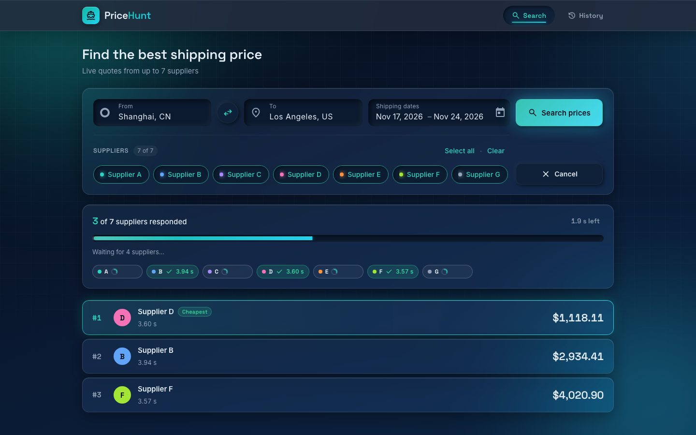
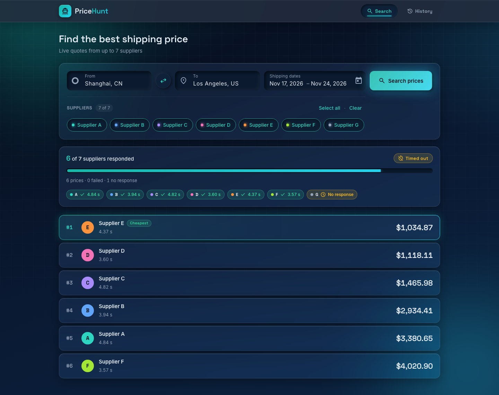
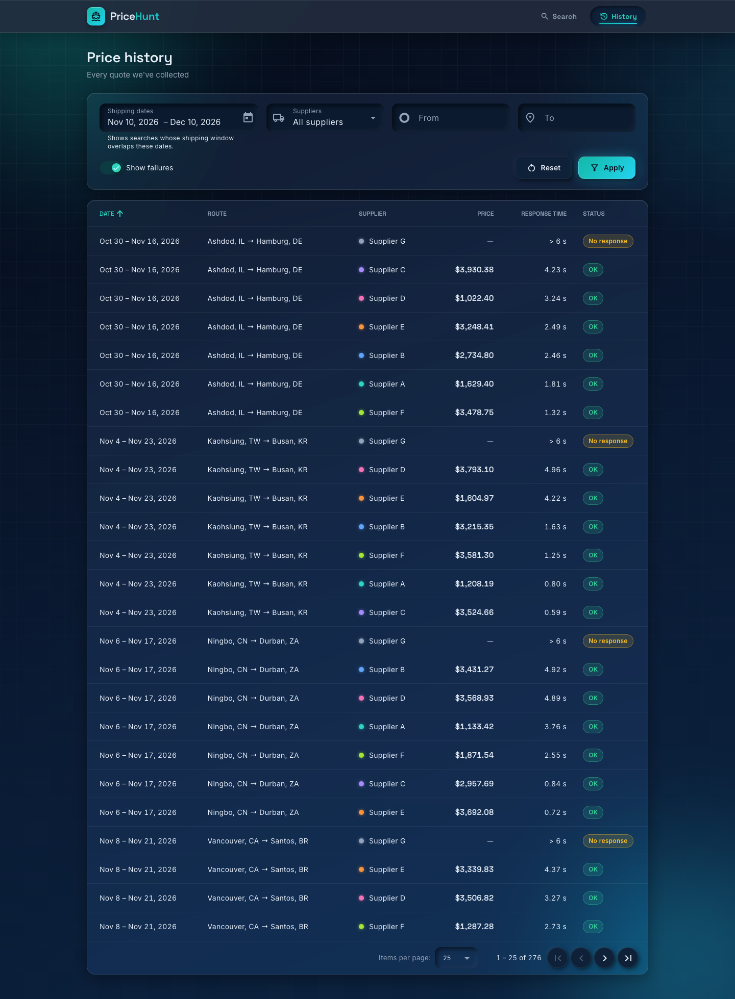
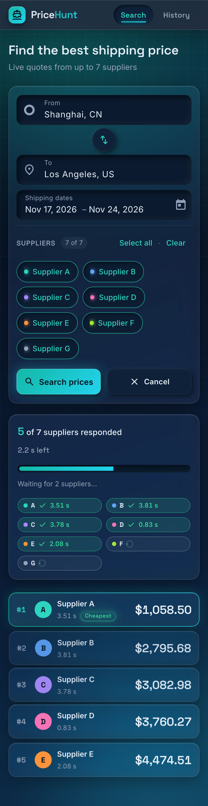
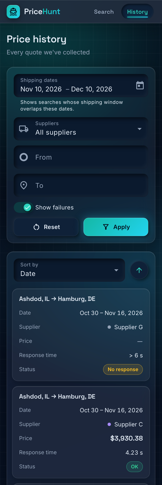

# PriceHunt

## 1. Overview

PriceHunt is my solution to the Ship4wd home assignment. You search for shipping prices between two ports for a
date range. The **.NET 10 API** asks up to seven simulated suppliers at the same time and **streams each answer to
the browser as soon as it arrives**, over Server-Sent Events. The **Angular 21** client keeps the list sorted from
cheapest to most expensive while results come in, without flicker or jumps. Every search has a hard 6-second limit
and can be cancelled. Cancelling stops the work on the server, down to the individual supplier calls. Every search
and every supplier response, including failures, is stored in SQLite through EF Core. A separate History screen
lets you filter by date, supplier and route, sort by any column and page through the results.

| Live search (running) | Finished: "Timed out", supplier G shows "No response" |
|---|---|
|  |  |



<table>
  <tr>
    <td align="center"><br><sub>Search, phone</sub></td>
    <td align="center"><br><sub>History, phone (row cards)</sub></td>
  </tr>
</table>

All 17 screenshots (idle, running, completed, cancelled, timed out, history default/empty/error/filters, desktop and
phone) are in [`docs/screenshots/`](docs/screenshots/).

### The seven simulated suppliers

The brief asks for seven suppliers behind one interface, each answering after a random 0.5–5 s with a random price,
where **one fails about 30% of the time** and **one never responds**. All seven are `SimulatedSupplier` instances
behind `ISupplierClient`, configured in [`appsettings.json`](server/PriceHunt.Api/appsettings.json) → `Suppliers`:

| Supplier | Behaviour | What you see |
|---|---|---|
| **A–E** | Random 0.5–5 s delay, random price ($800–$4,500) | A result card, inserted in price order |
| **F** | Same delay, then **fails ~30% of the time** (`"FailureRate": 0.3`) | Red **Failed** chip (tooltip: "Supplier F is temporarily unavailable"); counted as responded. The other suppliers are unaffected. Stored as `Failed`. |
| **G** | **Never responds** (`"NeverResponds": true`); waits until it is cancelled | Searches that include G end **Timed out** at 6 s with G as **No response**. Stored as `NoResponse`. |

Both behaviours are plain configuration, so changing the failure rate or the silent supplier needs no code change.
Failed and No-response rows are listed in History (Status column, "Show failures" toggle). F's 30% is random, so
it may take a few searches before you see it fail. The unit tests pin the random rolls to check the 30% rule exactly.

---

## 2. Run it

**Prerequisites**
- **.NET 10 SDK.** `server/global.json` pins `10.0.100` with `rollForward: latestFeature`.
- **Node 20.19+, 22.12+ or 24+** (Angular 21's engines range). Tested on Node 22.15.1 with npm 10.9.2.
  I used Angular 21 rather than 22 because Angular 22 needs Node ≥ 22.22.3, and I wanted it to run on a stock Node 22
  LTS with no extra setup.

You need one command per project, from the repo root, in two terminals:

```bash
dotnet run --project server/PriceHunt.Api      # API    → http://localhost:5080
```
```bash
cd client && npm start                         # client → http://localhost:4200
```

- `npm start` installs the packages first through a `prestart` script, so no separate `npm install` is needed.
- Open **http://localhost:4200**. There are two screens: **Search** (`/search`) and **History** (`/history`).
- The API is HTTP only, so no dev certificate is needed. CORS allows `http://localhost:4200`.
- **API reference (Scalar):** http://localhost:5080/scalar, available in Development, which is the default for `dotnet run`.
- **Database file:** `server/PriceHunt.Api/pricehunt.db` (SQLite, git-ignored). The API creates it on first start,
  applies the migrations and seeds 40 demo searches (228 supplier-response rows), so History has data right away.
- **Reset the database:** stop the API, delete `server/PriceHunt.Api/pricehunt.db*` (the `.db`, `-shm` and `-wal`
  files) and start the API again.
- Ports 5080 and 4200 must be free.

**A 1-minute tour**
1. **Search** with the defaults (all 7 suppliers): prices stream in and re-sort cheapest-first; supplier G never
   answers, so the search ends **Timed out** at 6 s.
2. Deselect **G** and search again: it ends **Completed** as soon as the last supplier answers.
   Repeat a few times: in roughly one search in three, **F** fails (red chip) while the others still return prices.
3. Start a search and press **Cancel**, or start a new one mid-flight: the old one stops and is stored as `Cancelled`.
4. Open **History**: filter by dates, suppliers and route, sort by any column, page through.
   Every search you just ran is there, failures included.

Quick check of the stream from a terminal (dates must be in the future):

```bash
curl -N -X POST http://localhost:5080/api/search/stream -H 'Content-Type: application/json' \
  -d '{"fromLocation":"CNSHA","toLocation":"USLAX","fromDate":"2027-03-01","toDate":"2027-03-10"}'
```

## 3. Tests

| Suite | Command | Result |
|---|---|---|
| Backend: xUnit unit and integration tests (`FakeTimeProvider`, `WebApplicationFactory`, temp SQLite file per class) | `dotnet test server` | 135 passed |
| Client unit tests (Vitest, the Angular CLI default) | `cd client && npm test -- --watch=false` | 207 passed (17 files) |
| E2E: Playwright, Chromium desktop 1280×800 and iPhone 13 | `cd client && npx playwright test` | 11 passed (~45 s) |

E2E notes:
- First run only: `cd client && npx playwright install chromium`.
- `playwright.config.ts` starts both apps itself. The API runs against a throwaway `pricehunt.e2e.db`, deleted
  before each run. It uses the real supplier timings and the 6 s timeout.
- Stop any dev servers on 5080 and 4200 first. Outside CI Playwright reuses a server that is already running, and
  that server would be using the dev database.
- One assertion (spec 4: "the earlier search is `Cancelled` in the DB") reads the E2E database with the `sqlite3`
  CLI, so `sqlite3` must be on `PATH`. macOS includes it.

---

## 4. Streaming approach: how and why

### How
The search endpoint streams results with **Server-Sent Events (SSE)** over a normal HTTP `POST`. As soon as a
supplier answers, the server pushes that price to the browser. It does not wait for the other suppliers.

The trick is that the response is never sent as one finished answer. The server sends the headers immediately and
keeps the response open; each time a supplier answers, it writes that one price as a small message and flushes it
to the network. The response only ends after the final message. On the browser side, `fetch` lets the client read
the response body piece by piece while it is still downloading, so each price shows up the moment it arrives.

A search sends a short sequence of messages:
1. **started**: the search began, with how many suppliers were asked.
2. One **quote** or **supplier-failed** per supplier, in the order they answer.
3. **end**: the final status (Completed or Timed out) and a summary.

The Angular client reads the stream with `fetch` and adds each price to the list as it arrives, keeping the list
sorted cheapest-first.

- **6-second limit:** a timer runs alongside the suppliers. If everyone answers sooner, the search ends straight
  away as Completed. If the timer fires first, the suppliers still waiting are stopped and recorded as No response,
  and the client gets a final **end** message saying Timed out, along with everything collected so far.
- **Cancellation:** when the user cancels, starts a new search or closes the tab, the client closes the request.
  The server notices the closed connection and passes the cancellation down to every supplier call, so all work
  stops at once. The search is saved as Cancelled.
- **No stale results:** each search on the client gets its own id. Anything that arrives late from an older search
  is ignored, so it can never appear in the new list.
- **Isolation:** each supplier runs on its own, and an error in one is recorded as a failure for that supplier
  only. The others keep going.

### Why SSE
- **The data only flows one way,** from server to client, which is exactly what SSE is for.
- **It's plain HTTP,** so it needs no extra libraries or protocols. It works through proxies and is easy to test
  from a terminal with `curl -N`.
- **Cancelling is just closing the request.** The server gets a built-in signal when the client goes away, which
  makes "stop the work when the client disconnects" simple and reliable.

**Alternatives I considered:**
- **SignalR / WebSockets:** two-way connections, which is more than a one-way stream needs. They add a hub,
  connection management and a custom "cancel" message.
- **Polling:** slower to show results and more requests. The server would also have to remember what each client
  has already received.
- **The browser's built-in `EventSource`:** it only supports `GET` and reconnects automatically. A dropped
  connection would quietly run the search again and save a duplicate. Using `fetch` avoids both problems and can
  be cancelled cleanly.

---

## 5. Database & tables

EF Core 10 with SQLite. The model is in [`PriceHuntDbContext`](server/PriceHunt.Api/Data/PriceHuntDbContext.cs), the
entities are in [`Data/Entities/`](server/PriceHunt.Api/Data/Entities), and the committed migration is
[`Data/Migrations/…_InitialCreate.cs`](server/PriceHunt.Api/Data/Migrations).

**`Searches`**, one row per search (entity `SearchRecord`)

| Column | SQLite type | Notes |
|---|---|---|
| `Id` | TEXT (GUID) | PK, `Guid.CreateVersion7()` (time-ordered) |
| `FromLocationCode` / `ToLocationCode` | TEXT(5) | UN/LOCODE, e.g. `CNSHA` |
| `FromLocationName` / `ToLocationName` | TEXT(64) | "Shanghai, CN". Denormalized for sorting and display |
| `FromDate` / `ToDate` | TEXT (`DateOnly`) | requested shipping window |
| `SelectedSuppliers` | TEXT | `"A,B,C"` via a value converter and a `ValueComparer` |
| `CreatedAt` | TEXT (UTC `DateTime`) | search timestamp |
| `EndedAt` | TEXT (UTC `DateTime`), null | |
| `DurationMs` | INTEGER, null | |
| `Status` | TEXT(16) | `Running` → `Completed` \| `TimedOut` \| `Cancelled` |
| `IsDemo` | INTEGER (bool) | marks seeded rows |

**`SupplierResponses`**, one row per selected supplier per search, failures included

| Column | SQLite type | Notes |
|---|---|---|
| `Id` | INTEGER | PK, autoincrement |
| `SearchId` | TEXT (GUID) | FK → `Searches.Id`, cascade delete |
| `SupplierCode` | TEXT(1) | `A`…`G` |
| `SupplierName` | TEXT(32) | denormalized |
| `Status` | TEXT(16) | `Success` \| `Failed` \| `NoResponse` (deadline hit) \| `Cancelled` (client cancelled) |
| `PriceCents` | INTEGER, null | null unless `Success` |
| `Currency` | TEXT(3) | `USD` |
| `ResponseTimeMs` | INTEGER | non-answerers get the elapsed time at the cut-off (e.g. 6000) |
| `ReceivedAt` | TEXT (UTC `DateTime`) | |
| `Error` | TEXT(200), null | failure reason |

**Indexes (7):** `Searches(FromDate, ToDate)` · `Searches(FromLocationCode, ToLocationCode)` · `Searches(CreatedAt)` ·
`SupplierResponses(SearchId)` · `SupplierResponses(SupplierCode)` · `SupplierResponses(Status)` · `SupplierResponses(PriceCents)`.
They support the History filters (date overlap, route, supplier, status) and the price sort.

**Why cents and UTC `DateTime`:** the EF Core SQLite provider cannot `ORDER BY` or compare `decimal` or
`DateTimeOffset` in SQL. History sorts by price and date in the database, so I store money as `long` cents and
timestamps as UTC `DateTime`. A converter forces `DateTimeKind.Utc` when reading, because SQLite returns
`Unspecified`. `DateOnly` works natively. Enums are stored as strings, so the file is readable in any SQLite browser.

**Schema on first run:** on startup
[`DatabaseInitializer`](server/PriceHunt.Api/Data/DatabaseInitializer.cs) runs `Database.MigrateAsync()`, then
`PRAGMA journal_mode=WAL;` so History reads don't block the writes from a running search. It then seeds the demo
data. A relative `Data Source` is resolved against the API's content root, so the file always ends up in
`server/PriceHunt.Api/` no matter where you start the API from. Nothing needs to be installed. The local `dotnet-ef`
tool is only needed to *add* migrations: `dotnet tool restore`, then
`dotnet ef migrations list --project server/PriceHunt.Api`.

**Demo seed:** [`DemoDataSeeder`](server/PriceHunt.Api/Data/DemoDataSeeder.cs) runs only when `SeedDemoData` is
true and `Searches` is empty. It is deterministic (`new Random(42)`) and uses dates relative to today. It creates
40 searches on random routes; 70% use all seven suppliers. The responses follow the real rules: F fails ~30% of the
time, and G is `NoResponse` whenever it is selected. About 10% of the searches are `Cancelled`. A fresh database has
**40 searches and 228 responses**. The spec said "about 150 rows", but its own rules (40 searches, 70% with all
seven suppliers) already imply at least 196, so I kept the rules and accepted the higher count
([DECISIONS](docs/DECISIONS.md)). The integration tests turn seeding off.

---

## 6. Design decisions & trade-offs

- **One API project, organised by feature** (Search, Suppliers, History, Data). Splitting it into separate layer
  projects felt like overkill for an app this size.
- **SSE instead of SignalR.** The stream only goes one way, and closing the request is all it takes to cancel
  (see §4).
- **Suppliers are driven by config.** Delays, F's failure rate and G's silence all live in `appsettings.json`.
  Time and randomness are injected, so the tests check the 6 s timeout and the 30% failure instantly.
- **Each result is saved as it arrives,** not in one batch at the end. If the user disconnects mid-search, what
  they already saw is still in History.
- **Money is stored as cents, dates as UTC.** EF Core's SQLite provider can't sort decimals in SQL, and History needs to sort by
  price in the database.
- **History filters by shipping dates.** "Prices for shipments in early December" felt more useful than "searches
  I ran on Tuesday". The search time is still shown in a tooltip.
- **History does its filtering, sorting and paging in the database,** and keeps the filters in the URL, so links
  can be shared and Back/Forward work.
- **No-jump re-ordering.** New prices go straight into the right place in the sorted list, and cards that move
  slide smoothly instead of jumping.
- **Angular Material for behaviour, custom styling for the look.** I got accessible date pickers, tables and
  paging for free, and gave them the dark glass style.
- **Angular 21 instead of 22,** so it runs on the standard Node 22 without an upgrade.

Smaller decisions are logged with their reasoning in [`docs/DECISIONS.md`](docs/DECISIONS.md).

---

## 7. What I'd do differently / with more time

- Real supplier integrations with retries and a circuit breaker, and a separate timeout per supplier.
- Postgres or SQL Server instead of SQLite once there are real users.
- Authentication, plus rate limiting on search, since every search hits seven suppliers.
- Short-term caching of identical searches.
- Monitoring: per-supplier latency, failure and timeout rates.
- A CI pipeline running all three test suites on every push, and Docker Compose to run everything together.
- Testing on real phones (Safari and Chrome), not just a simulated iPhone in Chromium.

---

## 8. Where AI was used

**Tools**
- **Claude (claude.ai chat), for planning.** Breaking down the requirements, then writing
  [`docs/SPEC.md`](docs/SPEC.md), [`docs/PLAN.md`](docs/PLAN.md) and [`CLAUDE.md`](CLAUDE.md). Claude asked the
  design questions and I answered every one: stack, SSE, supplier behaviour, history date semantics, the
  look and feel, testing and run commands.
- **Claude Code, for the implementation.** It ran autonomously on `main`. An Opus 5.5 orchestrating session (the "lead" below) handed
  each PLAN task to a fresh Claude Code subagent: Opus for design-heavy and concurrency-critical work (orchestrator,
  store review, theme, form, progress panel, result cards, History, E2E, final QA, README), Sonnet for most other
  implementers and reviewers, and Haiku for one small, scoped re-review. Plugins and skills:
  - **Superpowers**, with *subagent-driven development*: a fresh implementer subagent per task, test-first where
    the spec required it, then a spec-compliance and code-quality reviewer subagent, then fix rounds until the
    review was clean.
  - **Ralph Loop**: keeps the session going until the definition of done in `CLAUDE.md` is met.
  - **frontend-design** (official plugin): aesthetic guidance within the spec's design system.
  - **`ui-visual-qa`** (project skill, [`.claude/skills/ui-visual-qa`](.claude/skills/ui-visual-qa/SKILL.md)):
    Playwright screenshots of Search and History at phone, tablet and desktop sizes; automated checks for re-order
    jumps, flicker, sort order, overflow, console errors and axe accessibility; then the model reads every
    screenshot and scores it against a 10-point design rubric. A frontend task only passed when every check was
    green and every score was 4 or more.

**What AI generated:** essentially all code, tests, configuration and documentation in this repo, including this
README. A one-line entry per task is in [`docs/AI-USAGE.md`](docs/AI-USAGE.md). Every task was reviewed by a
separate AI reviewer before it was ticked. Decisions are logged in [`docs/DECISIONS.md`](docs/DECISIONS.md).

**My part:**
- I wrote the requirements with Claude and made every design decision during planning: stack, streaming
  approach, supplier behaviour, History date rules, look and feel.
- I reviewed the code and asked for clean-ups: making it more readable and removing unnecessary parts.
- I checked every requirement in the brief by hand against the running app and the database, using a checklist.

**Corrections made during the build** (by the AI reviewers and the lead session), for example:
- **Angular 22 → 21.** The first client scaffold used Angular 22 on a temporary Node 24. The lead session rejected it
  and had it re-scaffolded on Angular 21, so `npm start` works on the stock Node 22.
- **Entity rename.** A reviewer found a clash between the `Search` entity and the `PriceHunt.Api.Search` namespace,
  and the entity was renamed to `SearchRecord`.
- **Screenshot-timing artefact.** In the search form task, the lead session's own look at a screenshot caught a faded
  Search button and overlapping labels that the subagent's QA had missed. The cause was capture timing, not the UI.
  The capture script now waits for an enabled Search button, and regression tests were added.
- **Stale-result guard.** The store reviewer asked for a token-guard test that is *mutation-verified* (it fails when
  the guard is removed) and for the store's failure semantics to be logged in DECISIONS. Both were added.
- **Spec inconsistency.** The spec's "about 150 seed rows" contradicts its own generation rules. The lead session kept
  the rules and documented the 228 rows.

---

## 9. Requirement checklist

Requirements R1–R22 are the brief's requirements as numbered in [`docs/SPEC.md`](docs/SPEC.md) §1. Paths are relative to the repo root. `Unit/`, `Integration/` = `server/PriceHunt.Tests/…`; `*.spec.ts` under
`client/src/app/…`; `e2e/…` = `client/e2e/…`.

| # | Requirement | Implemented in | Covered by |
|---|---|---|---|
| R1 ✅ | 7 suppliers, common interface, simulated in-process | `server/PriceHunt.Api/Suppliers/ISupplierClient.cs`, `SimulatedSupplier.cs` (`SimulatedSupplier`, `SupplierRegistry`), `appsettings.json` → `Suppliers.Items` | `Unit/SimulatedSupplierTests.Builds_one_client_per_item_and_looks_up_case_insensitively`; `Integration/MetaEndpointsTests.Suppliers_ReturnsSevenWithOnlyCodeAndName` |
| R2 ✅ | Random 0.5–5 s delay, random price | `Suppliers/SimulatedSupplier.cs` (delay and price rolls); values in `Suppliers/SupplierOptions.cs` / `appsettings.json` (`MinDelayMs` 500 / `MaxDelayMs` 5000, `MinPrice` 800 / `MaxPrice` 4500) | `Unit/SimulatedSupplierTests.Does_not_complete_before_delay_and_completes_after`, `Max_random_gives_max_delay`, `Price_is_within_bounds`, `Random_prices_stay_in_bounds_with_two_decimals` |
| R3 ✅ | F fails ~30%, G never responds | `appsettings.json` (`FailureRate: 0.3`, `NeverResponds: true`), `SimulatedSupplier.GetQuoteAsync` | `Unit/SimulatedSupplierTests.Failure_roll_below_rate_throws_only_after_delay`, `Failure_roll_at_or_above_rate_succeeds`, `NeverResponds_does_not_complete_and_ends_with_cancellation` |
| R4 ✅ | Params: from/to location, from/to date, suppliers (default all) | `Search/SearchRequest.cs`, `Search/SearchRequestValidator.cs` | `Unit/SearchRequestValidatorTests.Valid_NullSuppliers_MeansAll` (+ 10 validation tests); `Integration/SearchStreamTests.InvalidRequest_Returns400ProblemDetails` |
| R5 ✅ | Stream each response as it arrives | `Controllers/SearchController.cs` (`TypedResults.ServerSentEvents`), `Search/SearchOrchestrator.cs` (`Task.WhenEach`) | `Integration/SearchStreamTests.Stream_WithG_TimesOut_AndFramesArriveIncrementally`; `Unit/SearchOrchestratorTests.Emits_Started_ThenQuotesInCompletionOrder_ThenCompletedEnd_WithoutWaitingForDeadline` |
| R6 ✅ | README explains streaming approach and reasoning | [§4 of this README](#4-streaming-approach-how-and-why) | Doc check: §4 covers how (SSE, flushing each price, message order, timeout, cancellation, stale results) and why (reasons + alternatives) |
| R7 ✅ | 6 s max; finish gracefully and tell the client | `SearchOrchestrator` (linked `CancellationTokenSource` on `TimeProvider`, `end` event), `appsettings.json` → `Search.TimeoutSeconds` | `Unit/SearchOrchestratorTests.NeverRespondingSupplier_TimesOutAtExactlySixSeconds_AndIsStoredAsNoResponse`; `e2e/01-search-default.spec.ts` "…ends Timed out at ~6 s"; `e2e/02-search-without-g.spec.ts` "search without G ends Completed in under 6 s" |
| R8 ✅ | Supplier failure doesn't affect others | `SearchOrchestrator.RunOneAsync` (never throws; exceptions become `Failed`) | `Unit/SearchOrchestratorTests.SupplierFailure_DoesNotAffectOthers` |
| R9 ✅ | Client cancel stops server work, reaches supplier calls | `SearchController` (`HttpContext.RequestAborted`), `SearchOrchestrator` (linked token, `finally` finalization), `SimulatedSupplier` (`Task.Delay(…, ct)`), `client/src/app/core/search-stream.service.ts` (`AbortController`) | `Unit/SearchOrchestratorTests.ClientCancel_CancelsSupplierTokens_StoresCancelled_AndEmitsNoEnd`, `AbandonedEnumeration_MidStream_StillPersistsCancelled`; `Unit/SimulatedSupplierTests.Cancellation_during_delay_stops_promptly_without_advancing_time`; `Integration/SearchStreamTests.ClientDisconnect_MarksSearchAndPendingSuppliersCancelled`; `core/search-stream.service.spec.ts` "aborts mid-stream on unsubscribe and stops emitting"; `e2e/03-search-cancel.spec.ts` |
| R10 ✅ | Angular form; all suppliers selected by default; progressive results | `client/src/app/features/search/search-form.ts` / `.html`, `shared/location-autocomplete.ts`, `features/search/result-list.ts` | `features/search/search-form.spec.ts` "selects all 7 suppliers by default" (+ 16 more); `e2e/05-search-validation.spec.ts`; `e2e/01-search-default.spec.ts` (counter increases) |
| R11 ✅ | List stays sorted cheapest → most expensive | `features/search/search.store.ts` (`insertSorted`, binary insert) | `features/search/search.store.spec.ts` `insertSorted` "orders by ascending price", "a large random sequence equals a full sort"; `features/search/result-list.spec.ts` "renders quotes in ascending price order whatever the arrival order…"; `e2e/01` (ascending on every animation frame) |
| R12 ✅ | No visible flicker or jump while re-ordering | `client/src/app/shared/flip-list.directive.ts`, `result-list.ts` (`track q.supplier`) | `shared/flip-list.directive.spec.ts` "slides an existing item from its old position…", "interrupts a running slide…", "reuses the same DOM element for an item across re-orders"; `result-list.spec.ts` "reuses the same DOM element for a supplier when the list re-orders"; `ui-visual-qa` run T3.2: 0 jumps / 0 flickers at 3 viewports ([final audit](docs/FINAL-AUDIT.md)) |
| R13 ✅ | Progress "X of N suppliers responded" + final state | `features/search/progress-panel.ts`, `supplier-status-strip.ts` | `progress-panel.spec.ts` "shows the counter in a polite live region and updates it…", "shows a neutral Cancelled badge…"; `supplier-status-strip.spec.ts` "marks waiting suppliers as No response (warning) on TimedOut"; `e2e/01` (Timed out), `e2e/02` (Completed) |
| R14 ✅ | New search cancels previous; no stale results | `search.store.ts` (`switchMap`, client token + `searchId` guard) | `search.store.spec.ts` "a new search resets state and aborts the previous one", "drops pipeline items carrying an old client token", "ignores events whose searchId does not match"; `e2e/04-search-new-mid-flight.spec.ts` (also checks the old search is `Cancelled` in the DB) |
| R15 ✅ | Persist every search (params, suppliers, timestamp, final status) | `Data/Entities/SearchRecord.cs`, `PriceHuntDbContext.cs`, `SearchOrchestrator` | `Unit/SearchOrchestratorTests.PersistsSearchAndEveryOutcome_WithCorrectFields`; `Integration/DatabaseTests.SearchWithResponses_RoundTrips`; `Integration/SearchStreamTests.ClientDisconnect_MarksSearchAndPendingSuppliersCancelled` |
| R16 ✅ | Persist every supplier response incl. failures | `Data/Entities/SupplierResponse.cs`, `SearchOrchestrator` (saves per event, finalization) | `Unit/SearchOrchestratorTests.PersistsSearchAndEveryOutcome_WithCorrectFields`, `SupplierFailure_DoesNotAffectOthers`; `Integration/HistoryEndpointTests.History_WithG_StoresNoResponse_AndIncludeFailuresFilters` |
| R17 ✅ | EF Core + SQLite; schema created on first run | `Data/DatabaseInitializer.cs` (`MigrateAsync` + WAL), `Data/Migrations/`, `Program.cs` | `Integration/DatabaseTests.FreshDbFile_IsMigratedOnStartup`; fresh-clone check T3.3 ([final audit](docs/FINAL-AUDIT.md)) |
| R18 ✅ | History endpoint: start/end date, suppliers (1/several/all), from/to | `Controllers/HistoryController.cs`, `History/HistoryQuery.cs`, `History/HistoryService.cs` | `Integration/HistoryEndpointTests.History_SupplierFilter_OneSeveralAll`, `History_FromToLocationFilter`, `History_DateWindow_ExcludesNonOverlappingSearches`, `History_InvalidParams_Return400ProblemDetailsWithErrors`; `Unit/HistoryServiceTests.Overlap_BothBounds`, `Overlap_StartOnly_UsesToDate`, `Overlap_EndOnly_UsesFromDate` |
| R19 ✅ | Separate history screen: start/end date, multi-select suppliers | `features/history/history-page.ts`, `history-filters.ts`, `history-url.ts`, `app.routes.ts` (`/history`) | `features/history/history-page.spec.ts` "Apply navigates with the edited filters…"; `history-url.spec.ts` (42 tests); `e2e/06-history.spec.ts` "filters + Apply update the URL, Back restores, failures toggle hides failed rows" |
| R20 ✅ | Table: Date, Route, Supplier, Price, Response Time; sortable; paginated | `features/history/history-table.ts` (`mat-table` + `matSort` + `mat-paginator`), `history-cards.ts` (phone), `HistoryService` (SQL sort + paging) | `Unit/HistoryServiceTests.Sort_EveryKey_AscAndDesc`, `Sort_Price_NullsLast_InBothDirections`, `Paging_IsStable_NoDuplicatesOrGaps_WithTies`; `e2e/06-history.spec.ts` "every column header sorts ascending and descending (server-side)", "next page and page size change"; `e2e/07-mobile.spec.ts` "mobile: History shows row cards instead of the table" |
| R21 ✅ | Git repo, two projects, one command each, no setup | `server/` + `client/`; `client/package.json` (`prestart: npm install`); `server/global.json`; HTTP-only `launchSettings.json` | Fresh-clone check T3.3: clone → both commands → all suites green ([final audit](docs/FINAL-AUDIT.md)); repeated in T3.5 from GitHub HEAD, suites now 135 / 207 / 11 ([final audit](docs/FINAL-AUDIT.md)); `client/playwright.config.ts`: Playwright starts the client with `npm start` and the API with `dotnet run` against a throwaway E2E database |
| R22 ✅ | README: run, streaming, DB, decisions, differently, AI | This README: §2, §4, §5, §6, §7, §8 | Doc check: every command in it was re-run for task T3.4 |

---

## 10. Project structure

```
PriceHunt/
├─ README.md · CLAUDE.md (agent rules) · dotnet-tools.json (local dotnet-ef)
├─ docs/  ActualInterviewInstructions.md (the brief) · FINAL-AUDIT.md · SPEC.md · PLAN.md · DECISIONS.md
│         AI-USAGE.md · screenshots/
├─ .claude/skills/ui-visual-qa/        visual QA skill (capture script + design rubric)
├─ server/
│  ├─ global.json · PriceHunt.slnx
│  ├─ PriceHunt.Api/
│  │  ├─ Controllers/   SearchController (SSE) · HistoryController · MetaController
│  │  ├─ Search/        SearchOrchestrator · SearchEvents · SearchRequest(+Validator) · SupplierOutcome
│  │  ├─ Suppliers/     ISupplierClient · SimulatedSupplier (+SupplierRegistry) · SupplierOptions · IRandomSource
│  │  ├─ History/       HistoryQuery · HistoryService · HistoryRowDto · PagedResult
│  │  ├─ Locations/     LocationCatalog (33 UN/LOCODE ports)
│  │  ├─ Data/          PriceHuntDbContext · Entities/ · Migrations/ · DatabaseInitializer · DemoDataSeeder
│  │  └─ Program.cs · appsettings.json
│  └─ PriceHunt.Tests/  Unit/ · Integration/ · TestDoubles/
└─ client/
   ├─ package.json · playwright.config.ts
   ├─ e2e/              01–07 *.spec.ts · fixtures.ts · helpers.ts
   └─ src/
      ├─ app/core/      search-stream.service · sse-parser · history.service · meta.service · api.models
      ├─ app/features/search/   search.store · search-form · progress-panel · supplier-status-strip · result-list · result-card
      ├─ app/features/history/  history-page · history-filters · history-table · history-cards · history-url
      ├─ app/shared/    flip-list.directive · location-autocomplete · format(.pipes)
      └─ styles/        tokens · glass · neu · typography · background · material-overrides
```
